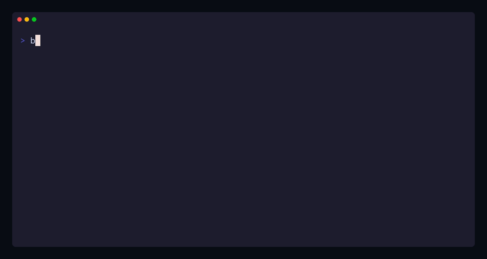

# fastvm

Micro-VMs that nap.

A single-host sandbox runtime built on Firecracker/KVM: sandboxes boot in
~100 ms, put themselves to sleep when idle, page their memory to disk, and wake
themselves when a packet arrives — with the frame already queued in the guest's
own virtio-net path.



One real session: boot a microVM, exec into it, pause it, page its RAM to disk,
wake it, and delete it.

## Features

- **~100 ms boots.** One Firecracker microVM per sandbox, KVM-backed.
- **Self-managed lifecycle.** Idle detection → pause (vCPUs halted, RAM
  resident) → dormant (RAM offloaded to a memory file) → destroy.
- **Wake on network.** A packet arriving for a sleeping sandbox wakes it, with
  the frame already queued in the guest's RX path. `curl` a dormant VM and it
  answers.
- **eBPF L2 switch** by default: tc redirect between TAPs and the uplink,
  sandbox isolation, MAC/IP anti-spoofing, ringbuf wake events — with an
  automatic Linux-bridge + AF_PACKET fallback.
- **Dockerfile → bootable disk.** `fastvm image build` turns a Dockerfile into a
  content-addressed ext4 base disk; runtime volumes are reflink CoW clones
  (sparse-copy fallback).
- **exec over virtio-vsock**, detached workloads, and an interactive PTY shell
  with resize and exit-code propagation.
- **Published ports** with nftables DNAT, including `curl 127.0.0.1:<port>`.
- **Baked-in coding-agent templates**: `fastvm template start claude|codex|copilot`.
- **Docker-style guest identity** on every boot (`/etc/hostname`, `/etc/hosts`,
  `/etc/resolv.conf` with host resolvers mirrored).
- **HTTP/JSON API + CLI**, event log, sandbox introspection, and graceful
  daemon-restart adoption of active sandboxes.

## Try it

Fastest path — boots a sandbox, lets it auto-sleep, then wakes it with `curl`:

```sh
make build && make assets   # binaries + pinned kernel
sudo make demo              # one-command wake-on-network demo
```

Manual loop — `fastvmd` in one root shell, CLI commands in another:

```sh
# terminal 1
sudo make start             # fastvmd with hack/config.yaml

# terminal 2 (as root)
make image                  # hack/Dockerfile.example -> demo:latest
bin/fastvm run --image demo:latest --name web -- /bin/sleep 3600
bin/fastvm ls
bin/fastvm exec web -- uname -a
bin/fastvm pause web --deep # page guest RAM to disk
bin/fastvm resume web       # wake it again
bin/fastvm rm web
```

Full walkthrough — config, images, PTY shell, wake-on-network, troubleshooting:
**[docs/GETTING_STARTED.md](docs/GETTING_STARTED.md)**.

## Requirements

Linux x86_64 with KVM, [Firecracker](https://firecracker-microvm.github.io/)
v1.10+ (v1.17 tested), and Go 1.24+ to build. The daemon needs
root/`CAP_NET_ADMIN` for TAP/veth/nftables; `CAP_BPF` enables the eBPF switch,
otherwise it falls back to the Linux bridge. Docker/BuildKit is optional and
only used to build base disks and template images.

## Documentation

| Document | What it covers |
|---|---|
| [Getting started](docs/GETTING_STARTED.md) | Build, config, images, sandboxes, shell, wake-on-network, testing, troubleshooting |
| [Design](docs/DESIGN.md) | Goals, architecture, lifecycle, storage, networking, security, roadmap |
| [CoW volumes](docs/SETUP_COW_VOLUME.md) | Loopback XFS setup, reflink verification |
| [Docs index](docs/README.md) | All documents and the repository layout |

## Development

```sh
make build     # bin/fastvm, bin/fastvmd, bin/fastvm-agent
make test      # unit tests (no KVM or root needed)
make test-race # unit tests under the race detector
make e2e       # real Firecracker boot/pause/dormant/wake e2e
```

Gated e2e, network, and Docker-build suites skip cleanly when their
prerequisites are missing — see
[docs/GETTING_STARTED.md § Testing](docs/GETTING_STARTED.md#10-testing) for the
commands and the verified test matrix.
