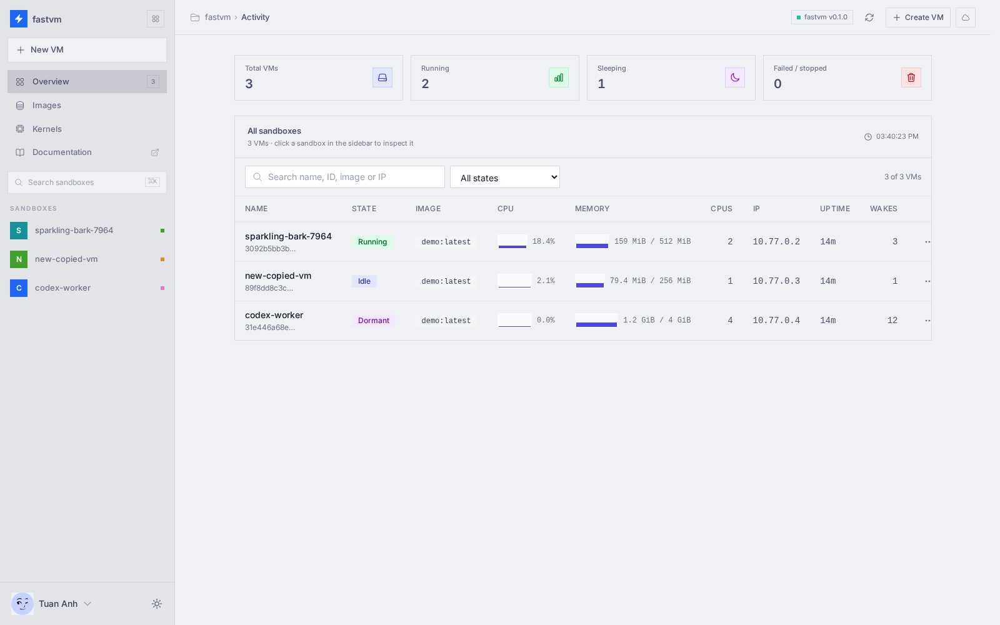

# fastvm

Micro-VMs that nap.

A single-host sandbox runtime built on **Cloud Hypervisor**/KVM: sandboxes
cold-boot in **~0.6 s** (measured to guest-agent-ready on the reference host),
put themselves to sleep when idle, page their memory to disk, and wake
themselves when a packet arrives — with the frame already queued in the guest's
own virtio-net path. Host directories can be shared into a sandbox over
virtio-fs.

> [!WARNING]
> **fastvm is under active development.** There is no stable release yet.
> APIs, CLI flags, config formats, storage layouts, and snapshot compatibility
> may change without notice. It is **not ready for production use** — run it
> only in disposable development or testing environments.



## CLI

The `fastvmctl` CLI provides a complete interface for managing sandboxes,
snapshots, images, volumes, and guest kernels.

#### &nbsp;&nbsp;Run a Command

> ```sh
> fastvmctl run --image python:3-alpine -- python3 -c "print('Hello from a microVM!')"
> ```

#### &nbsp;&nbsp;Create a Sandbox

> ```sh
> # Create and start a named sandbox
> fastvmctl run -d --net --image python:3-alpine --name app -- sh -c 'sleep infinity'
> ```
>
> ```sh
> # Execute commands
> fastvmctl exec app -- python -c "import this"
> fastvmctl exec app -- python -c "import urllib.request; print(urllib.request.urlopen('https://example.com').status)"
> ```
>
> ```sh
> # Snapshot now, restore later as an independent copy.
> fastvmctl snapshot app --name app-snap
> fastvmctl run --from-snapshot app-snap --name app2
> fastvmctl exec app2 -- python -c "print('Hello from the restored sandbox!')"
> fastvmctl snapshot rm app-snap
> ```
>
> ```sh
> # Lifecycle
> fastvmctl ps
> fastvmctl pause app --deep
> fastvmctl resume app
> fastvmctl rm app app2
> ```
>
> ```sh
> # Application logs and boot/kernel console
> fastvmctl logs app
> fastvmctl logs --source console app
> fastvmctl logs -f app
> ```

#### &nbsp;&nbsp;Kernel Management

> ```sh
> fastvmctl kernel remote-ls                              # kernels in cloud-hypervisor/linux
> fastvmctl kernel download ch-release-v7.2.8-20261009     # download + verify SHA-256
> fastvmctl kernel use ch-release-v7.2.8-20261009          # set the daemon default
> fastvmctl kernel ls                                      # installed + active
>
> # Pin one sandbox to a kernel while keeping the daemon default
> fastvmctl run --image alpine --kernel ch-release-v7.2.8-20261009 -- uname -a
> ```

#### &nbsp;&nbsp;Image Management

> ```sh
> fastvmctl image pull python:3-alpine   # Pull an OCI image
> fastvmctl image ls                     # List cached base images
> fastvmctl image rm python:3-alpine     # Remove an image
> ```

#### &nbsp;&nbsp;`.fvmfile`

> Save sandbox settings in a YAML file and run it with `--file`:
>
> ```yaml
> version: 1
> name: python
> image: python:3-alpine
> entrypoint: ["python3"]
> command: ["-c", "print('Hello from a .fvmfile')"]
> ```
>
> ```sh
> fastvmctl run -f my.fvmfile
> ```

#### &nbsp;&nbsp;Volumes and Ports

> ```sh
> # Writable block volume at /data
> fastvmctl run --image alpine --volume size=8GiB,mount=/data -- df -h /data
>
> # Host-directory share
> mkdir -p /tmp/share && echo hello >/tmp/share/hello.txt
> fastvmctl run --image alpine --volume /tmp/share:/mnt/share:ro -- cat /mnt/share/hello.txt
>
> # Publish a guest port and clean up
> fastvmctl run -d --net --image python:3-alpine --name web \
>   --publish 8080:8000 -- python3 -m http.server 8000 --bind 0.0.0.0
> curl http://127.0.0.1:8080
> fastvmctl rm web
> ```

#### &nbsp;&nbsp;Network Controls

> ```sh
> # Egress allowlist: only example.com is reachable
> fastvmctl run --image alpine --allow-host example.com -- \
>   wget -T 2 -t 1 -qO- https://example.com
> ```

More CLI details, including auto-publish, snapshots, and console access, are in
[docs/FASTVMCTL.md](docs/FASTVMCTL.md); see
[docs/GETTING_STARTED.md](docs/GETTING_STARTED.md) for the full walkthrough and
[docs/FVMFILE.md](docs/FVMFILE.md) for the config format.

## Install

```sh
make build && make assets   # binaries + pinned Cloud Hypervisor kernel
sudo make install

# terminal 1 — root daemon with the demo config
sudo fastvmd --config hack/config.yaml

# terminal 2
fastvmctl run --image alpine -- uname -a
```

## Features

- **Fast microVMs.** Cloud Hypervisor/KVM sandboxes boot to agent-ready in ~0.6 s.
- **Disposable or persistent.** `run` builds, boots, runs, and removes on exit;
  `-d` keeps it, and `resume` boots/wakes it later.
- **Self-managing.** Idle → pause → dormant RAM snapshot → wake on network.
- **On-demand images.** First use of an OCI image pulls it and caches a bootable
  disk automatically; compressed layers are shared across images.
- **Network control.** `--net`/`--no-net`, plus `--allow-host` egress allowlists.
- **First-boot setup.** Run a cloud-init-style `user_data` script before the sandbox command.
- **Snapshots.** Save RAM/CPU/disk and restore independent copies.
- **Volumes and ports.** virtio-fs host mounts, writable block data volumes, and
  published ports.
- **Declarative configs and console.** Run `.fvmfile` sandboxes (e.g. coding
  agents), and use the OIDC web console.

## Requirements

Linux x86_64 with KVM, [Cloud Hypervisor](https://www.cloudhypervisor.org/)
v54+ (`cloud-hypervisor`, or the static build `cloud-hypervisor-static`),
virtiofsd ≥ 1.10 (only for host-directory volumes), and Go 1.24+ to build. The
daemon needs root/`CAP_NET_ADMIN` for TAP/veth/nftables; `CAP_BPF` enables the
eBPF datapath, otherwise it falls back to the Linux bridge. Images are pulled
directly from OCI registries; no Docker daemon or CLI is required.

## Documentation

| Document | What it covers |
|---|---|
| [Getting started](docs/GETTING_STARTED.md) | Build, config, images, sandboxes, shell, wake-on-network, testing, troubleshooting |
| [Design](docs/DESIGN.md) | Goals, architecture, lifecycle, storage, networking, security, roadmap |
| [CoW volumes](docs/SETUP_COW_VOLUME.md) | Loopback XFS setup, reflink verification |
| [Cloud Hypervisor migration](docs/CLOUD_HYPERVISOR_MIGRATION.md) | Why the VMM moved from Firecracker to Cloud Hypervisor, kernel/tooling, virtio-fs volumes |
| [fastvmctl CLI](docs/cli/README.md) | Manpage-style reference for every command |
| [Kernel management](docs/cli/fastvmctl_kernel.md) | List, download, verify, and select guest kernels |
| [`.fvmfile` configs](docs/FVMFILE.md) | Declarative sandbox configs for coding agents and reproducible runs |
| [Auto-publishing ports](docs/AUTO_PUBLISH.md) | Discover guest TCP listeners and publish them on 127.0.0.1 |
| [Snapshots](docs/SNAPSHOT.md) | Save and restore sandbox memory, device state, and writable disk |
| [Sandbox lifecycle](docs/LIFECYCLE.md) | Running, idle, paused, dormant, wake, and auto-sleep |
| [REST API](docs/API.md) | Unix socket and optional TCP REST transport with mTLS |
| [Web console](console/README.md) | OIDC login, sandbox dashboard, live utilization, images, exec terminal |
| [Examples](examples/) | Coding agents, headless Chrome, GitHub Actions runner |
| [Prometheus metrics](docs/METRICS.md) | Daemon and per-sandbox metrics, scrape config |
| [Docs index](docs/README.md) | All documents and the repository layout |

## Development

```sh
make build     # bin/fastvmctl, bin/fastvmd, bin/fastvm-agent
make test      # unit tests (no KVM or root needed)
make test-race # unit tests under the race detector
make e2e       # real Cloud Hypervisor boot/pause/dormant/wake e2e
```

Gated e2e and network suites skip cleanly when their
prerequisites are missing — see
[docs/GETTING_STARTED.md § Testing](docs/GETTING_STARTED.md#10-testing) for the
commands and the verified test matrix.
